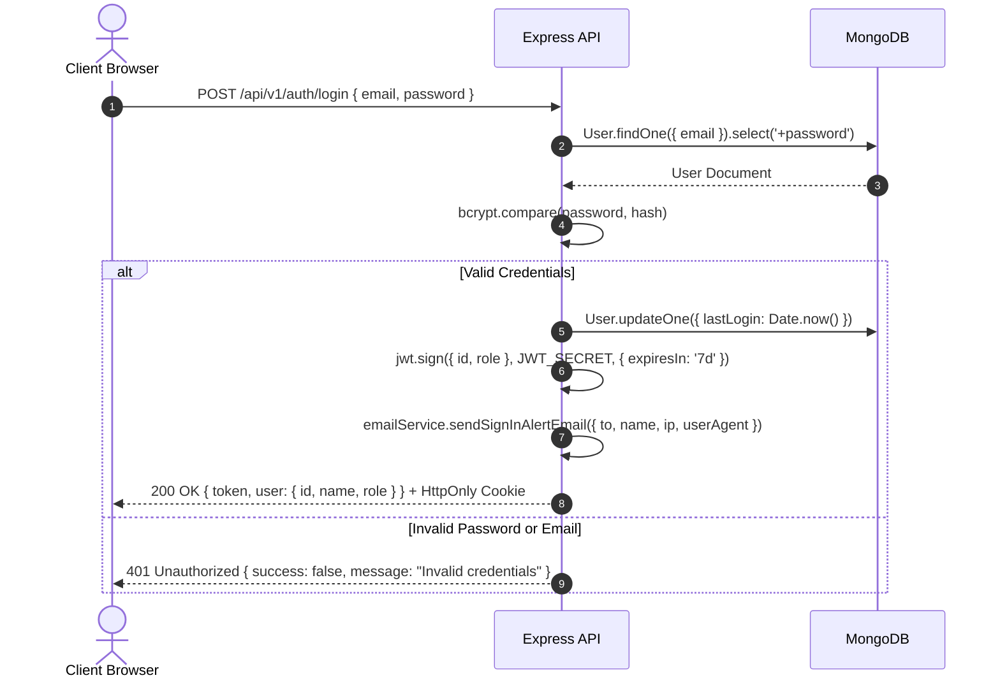
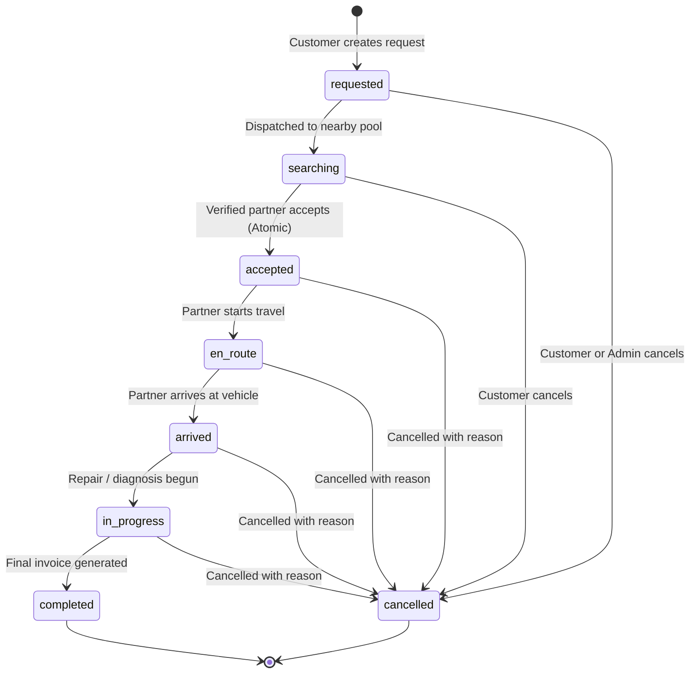

# Technical Architecture & System Documentation
## Roadside AAA — Roadside Vehicle Assistance & Mechanic Booking Platform

---

### 1. System Architecture Overview

Roadside AAA is structured as a decoupled, full-stack web application adhering to the Model-View-Controller (MVC) and event-driven architecture patterns.

```
                              ┌────────────────────────────────────────┐
                              │           React.js / Vite Client       │
                              │ (Tailwind CSS, Leaflet, Recharts, RRD) │
                              └───────────────────┬────────────────────┘
                                                  │
                                  HTTP REST / JSON │ WebSocket (Socket.IO)
                                                  │
                              ┌───────────────────▼────────────────────┐
                              │       Node.js / Express.js Server      │
                              │ (Helmet, CORS, RateLimit, CookieParser)│
                              └──────┬──────────────────────┬──────────┘
                                     │                      │
                             Mongoose ODM            Socket Event Bus
                                     │                      │
                      ┌──────────────▼──────────────┐   ┌───▼────────────────────────┐
                      │    MongoDB Database Cluster │   │ Authenticated Socket Rooms │
                      │  (GeoJSON, 2dsphere index)  │   │  (user:id, booking:id)     │
                      └─────────────────────────────┘   └────────────────────────────┘
```

---

### 2. Component Responsibilities

#### 2.1. Server (Node.js & Express)
- `src/config/db.js`: Initializes database connection with configurable MONGODB_URI and automatic zero-configuration fallback to `mongodb-memory-server` for smooth local testing and continuous integration.
- `src/models/*`: Mongoose schemas defining normalized entities, constraints, validators, and compound/2dsphere indexes.
- `src/middleware/auth.js`: JWT token verification and role-based authorization guards (`protect`, `restrictTo`).
- `src/middleware/errorHandler.js`: Centralized error catching, Mongoose CastError / ValidationError / Duplicate Key handling, and 404 responses.
- `src/services/pricingService.js`: Pure mathematical pricing logic calculating base fees, towing distance charges, line-item approvals, and 5% GST.
- `src/services/stateTransitionService.js`: Finite State Machine governing valid transitions (`requested -> searching -> accepted -> en_route -> arrived -> in_progress -> completed`).
- `src/sockets/socketHandler.js`: Socket.IO lifecycle handling, handshake authentication, and room-scoped event broadcasting.

#### 2.2. Client (React & Vite)
- `src/context/AuthContext.jsx`: Global authentication state, JWT persistence, auto-session validation, and Socket.IO connection lifecycle.
- `src/services/api.js`: Pre-configured Axios instance with automatic `Authorization: Bearer <token>` attachment and 401 handling.
- `src/components/maps/*`: Leaflet and React-Leaflet integration with custom SVG pin markers (`LocationPickerMap`, `LiveTrackingMap`).
- `src/layouts/*`: Role-specific layout wrappers (`UserLayout`, `PartnerLayout`, `AdminLayout`) with responsive navigation and active job alerts.

---

### 3. Authentication & Authorization Flow



#### Automated Email Notification Engine
Governed by `src/services/emailService.js` using `nodemailer`:
- **Registration (Welcome Email):** Sent automatically upon motorist or partner account creation with breakdown guidelines, 24/7 hotline (`1800-AAA-HELP`), and garage setup instructions.
- **Login (Security Alert):** Dispatched upon every successful authentication with timestamp (IST), IP address, and client user-agent string.
- **Transport Flexibility:** Automatically uses live Gmail (`SMTP_USER` + App Password) or any RFC-compliant SMTP provider in production. In development/testing, falls back smoothly to Ethereal Email test accounts with online preview URLs without failing requests.

---

### 4. Booking Lifecycle & State Transitions

The booking lifecycle is governed strictly by `src/services/stateTransitionService.js`. Direct status skipping is forbidden.



---

### 5. Atomic Partner Acceptance & Concurrency Protection

To guarantee that concurrent acceptance attempts by two nearby mechanics can never assign one service request to multiple partners, the server uses MongoDB's atomic `findOneAndUpdate` with a compound filter:

```javascript
const updatedRequest = await ServiceRequest.findOneAndUpdate(
  {
    _id: bookingId,
    status: { $in: ['requested', 'searching'] },
    assignedPartner: null, // Strict null constraint
  },
  {
    $set: {
      assignedPartner: partner._id,
      assignedPartnerUser: req.user.id,
      status: 'accepted',
      acceptedAt: new Date(),
    },
    $push: {
      statusHistory: {
        status: 'accepted',
        timestamp: new Date(),
        note: `Request accepted by partner ${partner.businessName}.`,
        updatedBy: req.user.id,
      },
    },
  },
  { new: true }
);

if (!updatedRequest) {
  // Another partner already accepted or booking was cancelled
  return res.status(409).json({
    success: false,
    message: 'This request is no longer available. It was already accepted.',
  });
}
```

---

### 6. Geospatial Partner Discovery Algorithm

1. User coordinates are confirmed as GeoJSON `[longitude, latitude]`.
2. Partner workshops are queried from MongoDB with `{ verificationStatus: 'verified', isAvailable: true }`.
3. Haversine distance is calculated between user coordinates and partner base workshop coordinates.
4. Partners whose distance exceeds their configured `serviceRadiusKm` (default 25 km) or `maxDistanceKm` are filtered out.
5. Eligible partners are sorted by proximity (`distanceKm` ascending) and populated with estimated price calculations.

---

### 7. Real-Time Socket Event Architecture

| Event Name | Direction | Payload | Room Scope | Purpose |
| :--- | :--- | :--- | :--- | :--- |
| `booking:join` | Client → Server | `bookingId` | None | Client requests admission to private booking room (Authorization verified on server). |
| `booking:leave` | Client → Server | `bookingId` | `booking:id` | Client leaves room. |
| `partner:location:update` | Client → Server | `{ bookingId, coordinates, heading }` | None | Assigned partner streams GPS updates (Validated on server). |
| `partner:location:updated` | Server → Client | `{ bookingId, coordinates, heading }` | `booking:id` | Broadcasts live position to customer and admin. |
| `chat:send` | Client → Server | `{ bookingId, message }` | None | Sends in-booking message (Persisted in DB before broadcast). |
| `chat:new-message` | Server → Client | `ChatMessage` document | `booking:id` | Real-time chat message delivery. |
| `booking:assigned` | Server → Client | `{ bookingId, partner }` | `booking:id` | Signals customer that mechanic is confirmed. |
| `booking:updated` | Server → Client | `{ bookingId, status }` | Global / Room | Signals status progression. |

---

### 8. Security Architecture & Threat Mitigations

- **Mass-Assignment Defense:** User role fields in registration payloads are sanitized; registering as `admin` directly is rejected with HTTP 400. Admin accounts can only be seeded or created by existing administrators.
- **Insecure Direct Object Reference (IDOR):** Vehicles, invoices, and service requests strictly verify that `entity.owner === req.user.id` or `entity.customer === req.user.id` before returning details or executing updates.
- **Strict Socket Room Authorization:** Socket clients cannot listen to arbitrary rooms by emitting `booking:join`. The server queries the database to confirm the socket's user is either the customer, assigned partner, or administrator.
- **Data Privacy on Partner Documents:** Partner verification licenses are accessible exclusively through protected `/api/v1/admin/partners` routes and never exposed on public discovery endpoints.
- **Rate Limiting:** Protects `/api/` endpoints from brute force and denial of service attacks.
